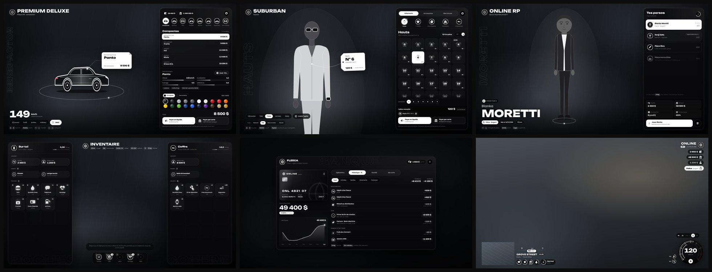

<div align="center">


</div>

```lua
local Bagou = {
    role    = "FiveM developer",
    team    = "InVek Corporation",
    working = "scripts & server bases",
    stack   = { "Lua", "JavaScript", "React" },
    shop    = "tebex.invek.shop",
}
```

<div align="center">


</div>

<br>

<div align="center">


</div>

<table>
<tr>
<td colspan="2">




      

**Base de serveur complète, toutes les interfaces dans une seule NUI, avec une DA noir et blanc maison.**
HUD + compteur, multi-perso et création de personnage, inventaire et coffres, supérettes et armurerie, banque et distributeurs, factures et menu patron, concession et garages, vêtements, coiffeurs et tatoueurs, menus F5 / F10 et boutique Tebex.
11 ressources sur un même core, plus de 1 000 tests Lua automatisés, serveur autoritaire contre les cheats.

</td>
</tr>
<tr>
<td width="50%" valign="top">


  

Simulateur Roblox : chaque coup donne **+1 force**. Un grand lobby partagé, des murs à casser (plus tu es faible, plus c'est long), un **mur boss géant** et des **courses de murs** en events, des pets aux mutations rares et une machine de fusion.

</td>
<td width="50%" valign="top">


  

Tycoon Roblox autour de l'aviation : boucle de vol, progression, boutique et effets de carte.

</td>
</tr>
<tr>
<td width="50%" valign="top">


  

Ressource FiveM pour tourner des vidéos au **Rockstar Editor** : pads d'animations pour les PNJ, scènes prêtes (accident...), pack graphique et ambiance. Tout se met en place en jeu avec `/plateau`.

</td>
<td width="50%" valign="top">


Nouveau projet en préparation.

</td>
</tr>
</table>

<p align="center"><sub>Les dépôts sont privés : le code reste protégé, le rendu est ici.</sub></p>

<br>

<div align="center">

<br><br>


<a href="https://tebex.invek.shop"></a>
<a href="https://discord.gg/InVek"></a>
<a href="https://github.com/InVekCorp"></a>

<br><br>


</div>
